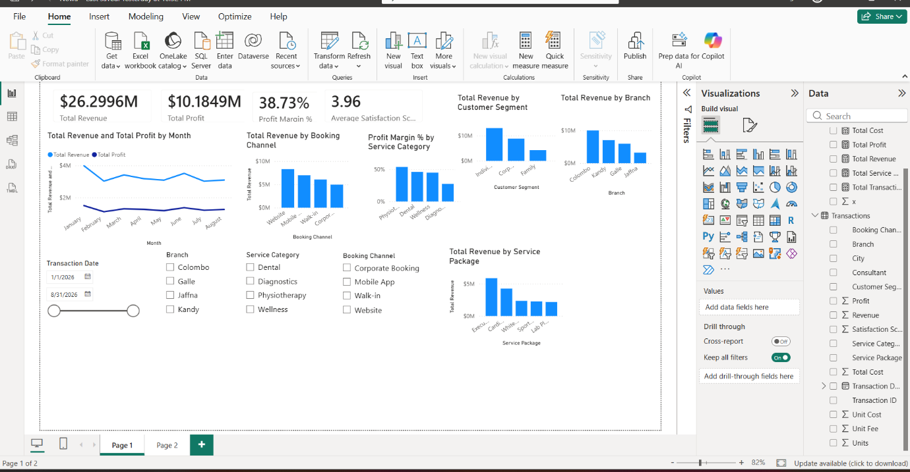

# LumaCare Health & Wellness: Power BI Sales & Profitability Dashboard

An end-to-end Power BI project: cleaning a deliberately messy transactional dataset, building DAX measures, designing an interactive executive dashboard, and turning the results into management recommendations.

> **Note:** This is an academic project (Data Visualization module, BAIT). LumaCare is a fictional company and the dataset is synthetic. No real business data is used.



---

## Business problem

LumaCare operates four branches (Colombo, Kandy, Galle, Jaffna) offering Wellness, Diagnostics, Dental and Physiotherapy services through four booking channels. Management believed revenue was growing but lacked a clear view of **profitability, branch performance, service performance and customer experience**.

The goal: transform the raw data into a clean model and an interactive dashboard that supports evidence-based decisions.

## Tools

- **Power BI Desktop**: modelling, visuals, slicers
- **Power Query (M)**: data cleaning and transformation
- **DAX**: measures

## Dataset

| Item | Detail |
|---|---|
| Raw rows | 907 transactions |
| Clean rows | 900 transactions |
| Period | Jan to Aug 2026 |
| Branches | 4 |
| Service categories | 4 (Wellness, Diagnostics, Dental, Physiotherapy) |
| Service packages | 12 |
| Booking channels | 4 (Website, Mobile App, Walk-in, Corporate Booking) |
| Customer segments | 3 (Individual, Corporate, Family) |

## Data preparation (Power Query)

| Issue found | Fix |
|---|---|
| 7 duplicate Transaction IDs | Removed with `Table.Distinct` on Transaction ID (907 to 900 rows) |
| Inconsistent Branch labels (`KANDY`, `colombo`, `Galle Branch`) | Trimmed and replaced, leaving exactly 4 branches |
| Inconsistent Service Category labels (`Diagnostic`, `Physio`, trailing spaces) | Trimmed and replaced, leaving exactly 4 categories |
| 8 missing Consultant values | Replaced with `"Unassigned"` (rows kept so revenue is not lost) |
| 5 missing Satisfaction Scores | Filled with the column average (deleting rows or using 0 would distort the KPI) |
| Transaction Date stored as a whole number | Converted to a proper Date type |

Calculated columns added at transaction level:

```
Revenue    = Units * Unit Fee
Total Cost = Units * Unit Cost
Profit     = Revenue - Total Cost
```

## DAX measures

All measures live in a dedicated `Key Measures` table.

```DAX
Total Revenue = SUM(Transactions[Revenue])
Total Cost = SUM(Transactions[Total Cost])
Total Profit = SUM(Transactions[Profit])
Profit Margin % = DIVIDE([Total Profit], [Total Revenue], 0)
Total Transactions = COUNTROWS(Transactions)
Total Service Units = SUM(Transactions[Units])
Average Satisfaction Score = AVERAGE(Transactions[Satisfaction Score])
```

## Dashboard

- 4 KPI cards: Total Revenue, Total Profit, Profit Margin %, Average Satisfaction Score
- Monthly Revenue and Profit trend
- Revenue by Branch
- Profit Margin % by Service Category
- Top 5 Service Packages by Revenue
- Booking Channel performance
- Customer Segment comparison
- 4 slicers: Date, Branch, Service Category, Booking Channel

**Headline KPIs:** Revenue $26,299,600 | Profit $10,184,900 | Margin 38.73% | Avg satisfaction 3.96

## Key findings

1. **Colombo leads on revenue but not on margin.** Colombo earns $10,021,300 (38.1% of total) at a 38.17% margin, while Galle has the strongest margin (41.37%) on much less revenue.
2. **Diagnostics is the biggest revenue driver and the least profitable.** It brings in $12,271,800 (46.7% of revenue) at a margin of only about 27.4%, versus about 53.9% for Physiotherapy.
3. **Kandy Diagnostics is the weakest branch/service combination:** 25.78% margin on $3,127,600 of revenue, the lowest of all 16 branch/category cells.
4. **Mobile App is the best channel on two measures at once:** highest margin (41.24%) and highest satisfaction (4.20). Website brings the most revenue ($8,312,800) but lower margin (39.34%) and the lowest satisfaction (3.85).
5. **Top packages:** Executive Screening, Cardiac Screening and Whitening.

A revenue-only view would hide finding 2 completely, which is the main reason the dashboard shows margin next to revenue.

## Recommendations

1. **Fix the Diagnostics margin gap.** Review the cost base branch by branch, starting with Kandy (consultant time, equipment/lab costs, pricing on Executive and Cardiac Screening).
2. **Learn from Galle and reduce Colombo concentration.** Study why Galle earns a higher margin at smaller scale, apply it to Colombo and Kandy, and grow Jaffna's revenue base.
3. **Shift volume toward the Mobile App.** It improves profitability and customer experience at the same time, so promote it over lower-margin channels such as Walk-in.

## Repository structure

```
├── README.md
├── LumaCare_PowerBI_Dashboard.pbix
├── report/
│   └── LumaCare_Submission_Report.pdf
└── screenshots/
    ├── dashboard.png
    ├── power-query-steps.png
    └── dax-measures.png
```

## Author

**MM Fathima Sumla**
Bachelor of Applied Information Technology (BAIT), Sri Lanka Technology Campus

[LinkedIn](#) | [GitHub](#)
